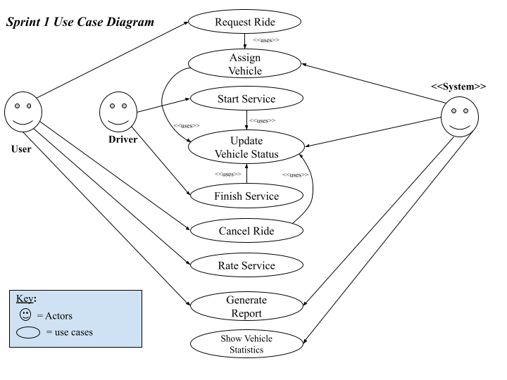
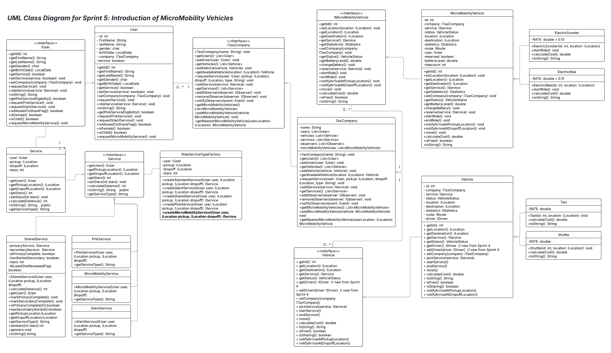

## Taxify – Ride Service Platform

Taxify is a Java-based simulation of a ride service platform featuring two main service types:
- Vehicles: taxis and shuttles
- Micro-mobility vehicles: electric scooters and bikes
  
Users can request rides with one of four service types— regular, shared (carpooling), pink (reserved for women and children), or silent — which apply only to vehicles (not micro-mobility).

The simulation assigns the nearest available vehicle or micro-mobility unit on a 10x10 grid and tracks detailed vehicle activity, including total distance traveled, revenue earned, and number of completed rides. Micro-mobility users must walk to the vehicle before starting the ride. All activity is logged to a structured file.

⸻

### Key Features:
- Vehicle ride types: Supports individual ride options— Regular, Shared, Pink, Silent
- Shared ride logic: A ride becomes shared only when one user is already in transit and another user requests a shared ride that is accepted by both. Users may have the same or different destinations
- Micro-mobility rides: Scooters and bikes require walking to the vehicle and include battery tracking
- Fixed datatset of 10 predefined users and 20 vehicles (10 vehicles, and 10 MM Vehicles)
- Developed randomized probabilistic logic for assigning drivers to vehicles, vehicles type (shuttle vs. taxi or e-scooter vs. e-bike), users service-type request (regular, shared, silent, pink, or a micro-mobility vehicle)
- Simulates real-time activity on a 10x10 grid with nearest-vehicle assignment
- Developed randomized probabilistic logic for assigning drivers to vehicles, vehicles type (shuttle vs. taxi or e-scooter vs. e-bike), users service-type request (regular, shared, silent, pink, or a micro-mobility vehicle)
- Tracks stats per vehicle: distance traveled, revenue generated, number of rides
- Simulation data output to a structured file (overwritten with each run)

#### Fare structure:
- Taxi: 2.00 per block
- Shuttle: 1.50 per block
- Bike: 0.25 per block + 1.00 reservation fee
- Scooter: 0.15 per block + 1.00 reservation fee
- 20% discount for Shared rides

## Sprint Documentation

This project was developed over five iterative sprints. The diagrams below illustrate the evolution of the system architecture and design throughout the development process.

---

### Sprint 1 – Initial System Design

  

**Use Case Diagram**

  

- Established the initial class structure
- Defined user interactions with the system
- Designed the vehicle assignment workflow

---

### Sprint 2 – Service Interaction Design

  

- Modeled ride request processing
- Defined communication between system components
- Refined service assignment logic

---

### Sprint 3 – Shared Ride Workflow

  

- Implemented shared ride interactions
- Added user acceptance workflow
- Improved ride coordination

---

### Sprint 4 – Micro-Mobility Architecture

  

- Added e-bike and e-scooter support
- Implemented battery tracking
- Added walking-to-vehicle functionality

---

### Sprint 5 – Final System Architecture

  

