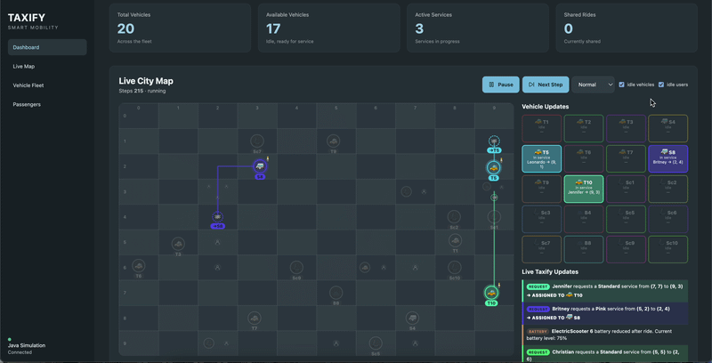
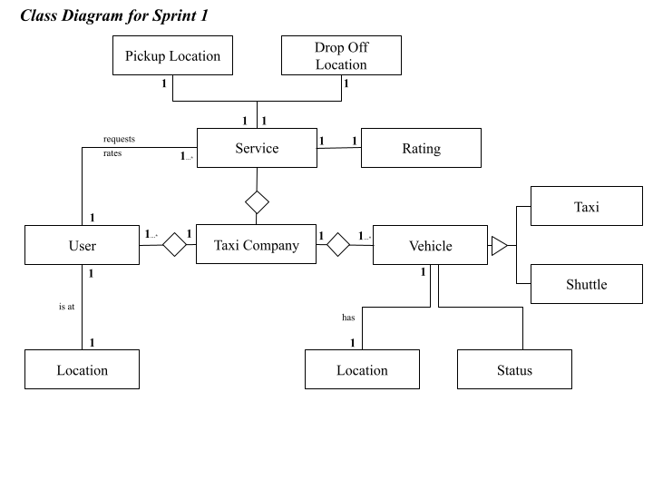
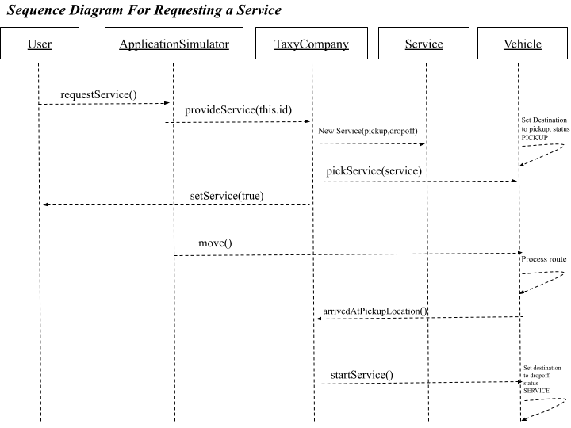
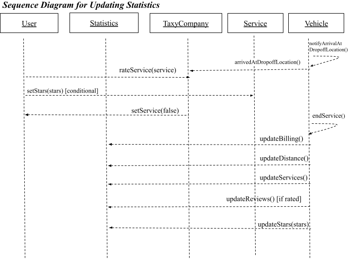
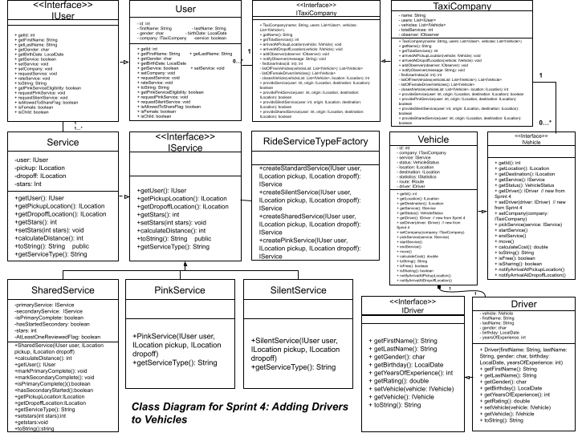
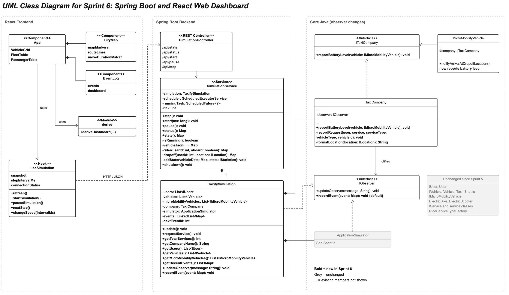

# Taxify

A ride-hailing simulation built in object-oriented Java, modelling the core operations of a transportation company. It brings together user and vehicle management, service allocation, ride processing and vehicle statistics within a simulated 10×10 city grid.

A Spring Boot backend runs the simulation, and a real-time React dashboard displays a map of ride activity, vehicle fleet statistics and user information.

The system was designed in UML and developed over six iterative sprints.

<p align="center">
  
</p>

<p align="center">
  
  
  
  
  
  
  
</p> 

<br>

<br>

<p align="center">
  <a href="#how-the-simulation-works">Simulation</a> ·
  <a href="#ride-types-and-services">Ride Types &amp; Services</a> ·
  <a href="#architecture">Architecture</a> ·
  <a href="#backend-and-dashboard">Backend &amp; Dashboard</a> ·
  <a href="#development-Progress">Development Progress</a> ·
  <a href="#setup-and-execution">Setup &amp; Execution</a>
</p>

## How the simulation works

The simulation follows a continuous ride-request and allocation process:

- **Service Requests:** Ride requests are generated probabilistically, determining the requesting user and service type.
- **User-Vehicle Matching:** The company filters vehicles by availability and the service's specific constraints, then assigns the closest one by Manhattan distance.
- **Ride Execution & Completion**: Vehicles handle movement between pickup and drop-off locations, completing the service upon arrival.
- **Vehicle Statistics + User Reviews:** Vehicles update their distance travelled, revenue and completed ride statistics. Users can rate completed rides, with ratings recorded in vehicle statistics. The company receives the updates. 

<br>

## Ride Types and Services

The simulation supports **vehicle rides** (taxis and shuttles) and **micro-mobility rides** (e-bikes and e-scooters), each with its own services, pricing and behaviour.

**Vehicle rides:** 

Taxi €2.00 / block · Shuttle €1.50 / block
- **Standard Service:** regular individual ride.
- **Shared Service:** a second passenger can join an ongoing ride if both accept, with different destinations allowed. Shared rides get a 20% discount.
- **Pink Service:** for women and children, driven by women.
- **Silent Service:** quiet ride.

**Micro-mobility rides:** 

E-bike €0.25 / block · E-scooter €0.15 / block · €1.00 reservation fee for both types 
- **Standard Service only:** the user reserves an available vehicle and walks to it to start the ride.
- Each ride uses 25% battery. E-bikes need more than 50% to start, otherwise they recharge to 100%. E-scooters recharge after three rides or at 50% or below.

<br>

## Architecture 
- **Company as coordinator:** `TaxiCompany` manages users and vehicles, assigns services and receives vehicle updates.
  - *Following the Single Responsibility Principle, allocation and business rules remain separate from vehicle movement, ride execution and statistics.*

- **Interfaces & Polymorphism:** The company interacts with vehicles and services through interfaces rather than depending on concrete classes.
  - *Loose coupling makes the system more flexible and extensible, allowing different vehicle types to be handled through shared logic.*

- **Inheritance:** Abstract `Vehicle` and `MicroMobilityVehicle` classes provide shared functionality to their concrete subclasses.
  - *Code reuse is achieved by implementing common behaviour once, while subclasses override methods such as `calculateCost()` and `startRide()` for vehicle-specific pricing and behaviour.*

- **Composition:** `SharedService` combines two `IService` objects to coordinate multiple passengers within a single journey.
  - *Combining existing service objects avoids duplicated functionality while supporting multiple passengers and destinations.*

- **Factory pattern:** `RideServiceTypeFactory` centralises the creation of different service types.
  - *Separating object creation from allocation logic improves maintainability and makes it easier to introduce new service types.*

- **Observer pattern:** `TaxiCompany` notifies registered observers of events such as service requests and battery changes.
  - *Loose coupling between simulation logic and presentation allows the dashboard observer to display events independently of the company.*

<br>

## Backend and Dashboard

The Spring Boot backend runs the simulation, and the React frontend displays the activity. They communicate through a REST API.

1. **Backend runs the simulation:** `SimulationService.java` runs `TaxifySimulation.java` on a single-threaded `ScheduledExecutorService`. Each tick calls `step()`, which advances the simulation and generates a new ride request every third tick. Access is `synchronized`, so the scheduler and incoming HTTP requests never modify the simulation at the same time.
2. **Frontend sends commands:** The dashboard calls `/api/start`, `/api/pause` and `/api/step`, which `TaxifyController.java` passes to `SimulationService.java`. Changing the speed restarts the scheduled task with a new interval.
3. **Backend returns the current state:** `/api/state` returns the full simulation as JSON: vehicles, users, statistics and the latest Observer events.
4. **Frontend displays the state:** `useSimulation.js` polls `/api/state` several times a second and animates vehicle movement between ticks. `deriveDashboard.js` then turns each snapshot into map markers, route lines and passenger-vehicle assignments.

<br> 

## Development Progress
This project was developed over six iterative sprints. The diagrams below illustrate the evolution of the system architecture and design throughout the development process.
  
<details>
<summary><b>Sprint 1: Initial system design</b></summary>

<br>

*Implemented the core domain classes (`Location`, `Route`, `Service`, `Statistics`, `User`, `ApplicationLibrary`) and modelled the system with a domain class diagram and a use case diagram.*



</details>
<details>
<summary><b>Sprint 2: Vehicles</b></summary>

<br>

*Added the abstract `Vehicle` class with `Taxi` and `Shuttle` subclasses, and let the company react when a vehicle arrives at a pickup or drop-off.*


</details>
<details>
<summary><b>Sprint 3: Company, Observer and simulation</b></summary>

*Built `TaxiCompany` with the Observer pattern (`ISubject`, `IObserver`) and a simulator that generates random requests and rides.*
 

</details>
<details>
<summary><b>Sprint 4: Drivers and service types</b></summary>

<br>

*Added drivers, Pink and Silent rides, and discounted Shared rides, with all services created through a factory.*
 

</details>
<details>
<summary><b>Sprint 5: Micro-mobility</b></summary>

<br>

*Added e-scooters and e-bikes with reservations, walking to the vehicle, an unlock fee and battery tracking.*


</details>
<details>
<summary><b>Sprint 6: Full-stack integration</b></summary>

<br>

*Gave users a location. Added a Spring Boot REST API and React dashboard. A new Observer records structured events (requests, battery levels) for the frontend to display.* 


</details>

<br>

## Setup and Execution

Requires Java, Maven, Node.js and npm.

```bash
# Backend
mvn spring-boot:run

# Frontend (new terminal)
cd frontend
npm install
npm run dev
```

Open the address Vite prints. For the console-only simulation, run `TestProgram`.

<!-- Taxify is a Java-based simulation of a ride service platform featuring two main service types:
- Vehicles: taxis and shuttles
- Micro-mobility vehicles: electric scooters and bikes
  
Users can request rides with one of four service types— regular, shared (carpooling), pink (reserved for women and children), or silent — which apply only to vehicles (not micro-mobility).

The simulation assigns the nearest available vehicle or micro-mobility unit on a 10x10 grid and tracks detailed vehicle activity, including total distance traveled, revenue earned, and number of completed rides. Micro-mobility users must walk to the vehicle before starting the ride. All activity is logged to a structured file.

⸻

### Key Features:
- Vehicle ride types: Supports individual ride options— Regular, Shared, Pink, Silent
- Shared ride logic: A ride becomes shared only when one user is already in transit and another user requests a shared ride that is accepted by both. Users may have the same or different destinations
- Micro-mobility rides: Scooters and bikes require walking to the vehicle and include battery tracking
- Fixed datatset of 10 predefined users and 20 vehicles (10 vehicles, and 10 MM Vehicles)
- Developed randomized probabilistic logic for assigning drivers to vehicles, vehicles type (shuttle vs. taxi or e-scooter vs. e-bike), users service-type request (regular, shared, silent, pink, or a micro-mobility vehicle)
- Simulates real-time activity on a 10x10 grid with nearest-vehicle assignment
- Developed randomized probabilistic logic for assigning drivers to vehicles, vehicles type (shuttle vs. taxi or e-scooter vs. e-bike), users service-type request (regular, shared, silent, pink, or a micro-mobility vehicle)
- Tracks stats per vehicle: distance traveled, revenue generated, number of rides
- Simulation data output to a structured file (overwritten with each run)

#### Fare structure:
- Taxi: 2.00 per block
- Shuttle: 1.50 per block
- Bike: 0.25 per block + 1.00 reservation fee
- Scooter: 0.15 per block + 1.00 reservation fee
- 20% discount for Shared rides

#### Micro-Mobility Battery Management
- Electric Bikes: Must have more than 50% battery charge to start a ride. If the battery level is 50% or below, the bike automatically recharges to 100% before the ride begins.
- Electric Scooters: Automatically recharge according to the implemented battery and ride-count conditions.
- Battery levels decrease by 25% after each completed micro-mobility ride.
- The system tracks battery levels and completed rides for each micro-mobility vehicle.

## Sprint Documentation

This project was developed over five iterative sprints. The diagrams below illustrate the evolution of the system architecture and design throughout the development process. I added an additional sprint, to go back and correct some logical errors such as how users location was handeled and to add a react frontend and sprinboot backend to create a grahical interface to view the simulation. 

---

### Sprint 1 – Initial System Design

<p align="center">
  
</p>

**Use Case Diagram**

<p align="center">
  
</p>

- Established the initial class structure
- Defined user interactions with the system
- Designed the vehicle assignment workflow

---

### Sprint 2 – Service Interaction Design

<p align="center">
  
</p>

- Modeled ride request processing
- Defined communication between system components
- Refined service assignment logic

---

### Sprint 3 – Shared Ride Workflow

<p align="center">
  
</p>

- Implemented shared ride interactions
- Added user acceptance workflow
- Improved ride coordination

---

### Sprint 4 – Micro-Mobility Architecture

<p align="center">
  
</p>

- Added e-bike and e-scooter support
- Implemented battery tracking
- Added walking-to-vehicle functionality

---

### Sprint 5 – Final System Architecture

<p align="center">
  
</p> -->
